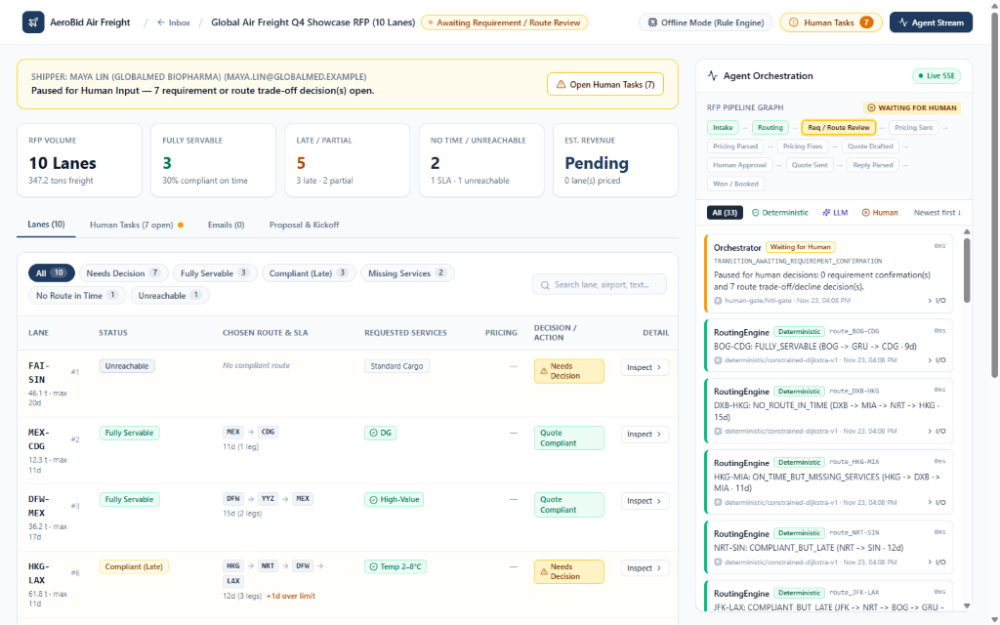

# AeroBid Air Freight — AI-Powered RFP Automation Platform

AeroBid automates custom air-freight Request for Proposal (RFP) evaluation from messy shipper email + Excel ingestion through constrained multi-leg flight routing, internal Pricing Desk negotiation, formal customer quoting, and post-acceptance kickoff scheduling—built with strict separation between **deterministic algorithms** (constrained Dijkstra shortest path on service-filtered flight graphs, exact unit normalization, deterministic pricing arithmetic, RFC 5545 `.ics` generation) and **schema-validated LLM agents** (unstructured shipper intake, messy pricing reply parsing, customer email prose, and bilingual deal-desk triage) gated by explicit **human-in-the-loop approvals**.

---

## Visual Walkthrough

### RFP Workspace & Route Trade-Off Assessment


### Human Tasks Queue (Route Trade-Offs, Pricing Anomalies & Quote Sign-Off)


### Accepted Proposal Summary & Kickoff `.ics` Invite


---

## Quick Start

### 1. Offline Mode (Zero API Key — 2 Commands)

The repository runs end-to-end with zero external credentials using the deterministic rule-based intake/pricing/deal engines and a pre-seeded 10-lane showcase RFP covering all five feasibility buckets from `Air_Freight_RFP_Mock_Data.xlsx`:

```bash
npm install
npm run dev
```

Open [http://localhost:3000](http://localhost:3000) to inspect the pre-seeded showcase RFP, upload a `.xlsx` workbook, or enter custom lanes directly.

> **Using `pnpm` & WSL Note:** All `package.json` scripts (`test`, `e2e`, `eval`, `lint`, `typecheck`, `check:secrets`) work identically with `pnpm` (`pnpm install && pnpm dev`, `pnpm test`, `pnpm e2e`, `pnpm eval`) on Linux/macOS/WSL. If running on Windows against a WSL repository path (`\\wsl.localhost\...`), execute `npm` / `pnpm` and `next build` / `next dev` inside your WSL Linux shell rather than over a Windows UNC mount to avoid Plan9/symlink issues.

### 2. Enabling Live LLM Mode & Optional SMTP

Copy the environment template and provide either a Gemini API key (default provider: `gemini-2.5-flash`) or OpenAI key (`gpt-4o-mini` fallback):

```bash
cp .env.example .env.local
# Edit .env.local and set GEMINI_API_KEY=... or OPENAI_API_KEY=...
npm run dev
```

Optional `.env.local` controls:
- `LLM_PROVIDER=auto | gemini | openai | offline` (or toggle per-session from the UI header pill)
- `LLM_MAX_RPM=30` (sliding 60-second rate cap on live LLM requests)
- `LLM_MAX_COST_USD_PER_RUN=0.50` (cumulative USD spend guardrail per client instance)
- `SMTP_HOST`, `SMTP_PORT`, `SMTP_SECURE`, `SMTP_USER`, `SMTP_PASS`, `SMTP_FROM` (when unset, clicking **Approve & Send** stores the customer quote in the in-app outbox without needing an external mail server)

### 3. Docker & Deployment Status

Build and run with persistent SQLite storage mounted at `/data`:

```bash
docker build -t air-freight-rfp-agent .
docker run -p 3000:3000 -v rfp_data:/data -e LLM_PROVIDER=offline air-freight-rfp-agent
```

**Cloud Deployment Note:** A production multi-stage `Dockerfile` and `.dockerignore` are included (tested build architecture on `node:22-bookworm-slim` with `DATABASE_URL=file:/data/rfp.db` and `Air_Freight_RFP_Mock_Data.xlsx` baked in). Live cloud deployment (Render / Railway / Vercel+Turso) was skipped per the brief's >1-hour rule because the Docker daemon is disabled in this environment and no external cloud CLI/remote account is configured locally; local execution via `npm run dev` or the Docker image requires zero external infrastructure.

---

## Architecture Overview


### Design Principle: Code Where There Is a Right Answer, LLM Where There Isn't

| Subsystem | Deterministic Code | AI / LLM Role | Fail-Closed Guardrail |
| :--- | :--- | :--- | :--- |
| **XLSX Parsing & Validation** | Pure JS ZIP+SAX parser (`saxes`), airport & numeric validation | None | Invalid rows collected into `DataIssue[]`, never crash |
| **Requirement Extraction** | Pattern/negation/O-D rule baseline (`extractRequirementsOffline`) | Structured extraction (`IntakeLlmOutputSchema`) + dual-reading diff | LLM/rule disagreement, ungrounded quote, or confidence `< 0.85` -> `CONFIRM_REQUIREMENTS` human task |
| **Flight Routing** | Multi-hop constrained Dijkstra minimizing days then legs (`findBestRoute`) | None (never delegated to LLM) | Exact leg-level service gap attribution (`LegServiceGap[]`) |
| **Pricing Normalization** | `/kg` -> `/ton` (`x1,000`), range bounds (`$500–$15,000/t`), duplicate/range checks | Unstructured Pricing reply parsing & mock prose generation | Missing, ambiguous, ungrounded, or out-of-range prices -> `CLARIFY_PRICING` human task; zero silent guessing |
| **Quote Assembly** | Lane tables, routes, SLAs, service status, `$` totals, plain-text mirror | Optional greeting, executive summary, closing only | Hard gate blocks sending until `APPROVE_QUOTE` sign-off and zero unresolved tasks |
| **Deal & Kickoff** | `proposal_lanes` persistence, `.ics` UTC conversion (`10:00 ET`), agenda | Structured classification of customer reply intent (`DealAgent`) | Tentative, question, invalid JSON, or French reply in offline mode -> `CUSTOMER_REPLY_REVIEW` task |

---

## Brief Requirements -> App & Code Mapping

| Brief Requirement | Where It Lives in the App | Where in the Code |
| :--- | :--- | :--- |
| **Ingest shipper RFP `.xlsx` & email + Transit Table** | Inbox **Upload Excel (.xlsx)**, **Paste / Compose RFP**, and **Presets** (`/`), `POST /api/rfps` | [`src/domain/xlsx-reader.ts`](src/domain/xlsx-reader.ts), [`src/domain/loader.ts`](src/domain/loader.ts), [`src/components/RfpInboxClient.tsx`](src/components/RfpInboxClient.tsx) |
| **Extract special requirements & confidence** | Lane Detail Drawer **Shipper Email & Highlighted Evidence** (`evidenceJson`, confidence %) | [`src/domain/requirements.ts`](src/domain/requirements.ts), [`src/agents/intake.ts`](src/agents/intake.ts), [`data/gold_requirements.json`](data/gold_requirements.json) |
| **Route freight across flights & identify trade-offs** | Workspace summary cards, filtered **Lanes** table with airport chips, and Drawer route comparison | [`src/domain/routing.ts`](src/domain/routing.ts), [`src/domain/assessment.ts`](src/domain/assessment.ts), [`src/components/LaneTable.tsx`](src/components/LaneTable.tsx), [`src/components/LaneDetailDrawer.tsx`](src/components/LaneDetailDrawer.tsx) |
| **Email Pricing team & simulate unstructured reply** | **Request Pricing** banner + **Emails** tab **Pricing Desk Thread** | [`src/agents/pricing.ts`](src/agents/pricing.ts), [`src/pricing/mock-pricing-team.ts`](src/pricing/mock-pricing-team.ts), [`src/components/EmailsPanel.tsx`](src/components/EmailsPanel.tsx) |
| **Parse messy pricing reply & flag anomalies** | **Human Tasks** queue (`CLARIFY_PRICING`: **Send Clarification Email** or **Save Manual Rate**) | [`src/agents/pricing.ts`](src/agents/pricing.ts), [`src/components/HumanTasksPanel.tsx`](src/components/HumanTasksPanel.tsx) |
| **Draft & approve customer proposal email** | **Proposal & Kickoff** preview (`Markdown` + plain-text) & **Approve & Send** gate | [`src/agents/quote.ts`](src/agents/quote.ts), [`src/lib/email/smtp.ts`](src/lib/email/smtp.ts), [`src/app/api/rfps/[id]/quote/approve-send/route.ts`](src/app/api/rfps/%5Bid%5D/quote/approve-send/route.ts) |
| **Simulate customer reply, book deal & `.ics` kickoff** | **Customer Quote Thread** simulator buttons (`Accept All`, `Accept Partial`, `Question`, `Unclear`, `Reject`) & downloadable `kickoff.ics` | [`src/agents/deal.ts`](src/agents/deal.ts), [`src/deal/mock-customer.ts`](src/deal/mock-customer.ts), [`src/deal/ics.ts`](src/deal/ics.ts), [`src/app/api/rfps/[id]/kickoff.ics/route.ts`](src/app/api/rfps/%5Bid%5D/kickoff.ics/route.ts) |
| **Real-time orchestrator state machine & observability** | **Pipeline Graph** + live SSE **Agent Stream** drawer (`agent_events` log) | [`src/orchestrator/states.ts`](src/orchestrator/states.ts), [`src/orchestrator/engine.ts`](src/orchestrator/engine.ts), [`src/orchestrator/event-bus.ts`](src/orchestrator/event-bus.ts), [`src/components/AgentOrchestrationPanel.tsx`](src/components/AgentOrchestrationPanel.tsx) |
| **11-table relational persistence** | SQLite DB (`file:./data/rfp.db` in Node/Linux; auto `:memory:` on UNC mounts) | [`src/db/schema.ts`](src/db/schema.ts), [`src/db/migrate.ts`](src/db/migrate.ts), [`src/db/index.ts`](src/db/index.ts) |

---

## Human-in-the-Loop Design

Every state that modifies binding commitments, commercial terms, or resolves incomplete AI extractions forces the orchestrator into `WAITING_FOR_HUMAN` and creates a persistent `human_tasks` record:

1. **`CONFIRM_REQUIREMENTS` (`AWAITING_REQUIREMENT_CONFIRMATION`)**: Triggered if the rule baseline and LLM disagree, an evidence quote is ungrounded in the shipper email, confidence is below `0.85`, or the shipper requests an out-of-catalog service (e.g., `-20 C` frozen or dry ice). Prevents mispricing unsupported cold-chain equipment.
2. **`LANE_ROUTE_DECISION` (`AWAITING_REQUIREMENT_CONFIRMATION`)**: Triggered for `COMPLIANT_BUT_LATE`, `ON_TIME_BUT_MISSING_SERVICES`, `NO_ROUTE_IN_TIME`, and `UNREACHABLE` lanes. Commercial reps explicitly choose whether to pitch a late-but-compliant route, pitch an on-time route disclosing missing services, or decline—rather than letting an AI silently relax customer constraints.
3. **`CLARIFY_PRICING` (`AWAITING_PRICING_FIXES`)**: Triggered for missing rates, multi-figure ranges, ungrounded quotes, or out-of-range prices (`< $500/t` or `> $15,000/t`). Operators can trigger an automated Pricing clarification round-trip or enter a verbally approved spot rate.
4. **`APPROVE_QUOTE` (`AWAITING_APPROVAL`)**: Hard backend gate (`ApprovalGateError`, HTTP `409`) blocking quote dispatch until an RFP analyst is recorded (`approved_by`, `approved_at`) and zero open pre-quote tasks remain (unless explicitly overridden with an exception note).
5. **`CUSTOMER_QUESTION` & `CUSTOMER_REPLY_REVIEW` (`NEEDS_FOLLOW_UP`)**: Triggered on customer questions, low-confidence/hedged intent, empty replies, or non-English (e.g., French) replies parsed in Offline Mode—preventing false deal booking (`WON`/`LOST`) without human sign-off.

---

## Key Results on `Air_Freight_RFP_Mock_Data.xlsx`

All numbers below are reproducible from scripts in `scripts/` and verified by CI:

### Dataset & Routing Analysis (`scripts/analyze-data.py` & `tests/domain/assessment.test.ts`)
- **Workbook Scope:** `100` unique shipper lanes (`4,008.4` total metric tons) over `100` directed flights across `20` airports.
- **100/100 TypeScript-to-Python Parity:** Every classification, shortest transit time, leg count, and chosen airport sequence matches the independent Python reference analyzer (`tests/domain/assessment.test.ts`):
  - `FULLY_SERVABLE`: **45 lanes** (including **15/15** "standard general cargo / no special services" lanes)
  - `COMPLIANT_BUT_LATE`: **44 lanes** (35 have a faster non-compliant alternative; 9 have no on-time option)
  - `ON_TIME_BUT_MISSING_SERVICES`: **5 lanes**
  - `NO_ROUTE_IN_TIME`: **1 lane**
  - `UNREACHABLE`: **5 lanes** (involving `ANC` or `FAI`, which have no edges in the Transit Table)

### Intake Evaluation (`npm run eval:intake -- --mode offline` -> `out/eval_intake.md`)
- **Exact-Match Rate vs 100 Gold Labels (`data/gold_requirements.json`):** **100 / 100 (100.00%)**
- **Micro Precision / Recall / F1:** **100.00% / 100.00% / 100.00%** across all 5 service types (`TEMP_CONTROLLED`, `DANGEROUS_GOODS`, `HIGH_VALUE_SECURITY`, `FRAGILE`, `OVERSIZED`) and **15/15** Standard Cargo negative controls
- **Cost & Speed (Offline Mode):** **\$0.000000** token cost, **`0` human-task false alarms**, **50 ms** wall time. *(Live Gemini/OpenAI eval runs cleanly with `--mode auto` when a funded API key is configured; all live LLM retry/schema/timeout/merge paths are also unit-tested against stubbed structured transports.)*

### Pricing Parser Evaluation (`npm run eval:pricing` -> `out/eval_pricing.md`)
Evaluated across **5 batches / 40 lane-quote instances** against hidden deterministic true prices:
- **Clean Priced Lanes Exact-Match Rate:** **29 / 29 (100.00%)** (`USD_PER_T`: 11/11, `DOLLAR_PER_TON`: 9/9, `PER_KG` x 1,000: 9/9)
- **Intentional Anomaly Detection:** **11 / 11 (100.00%)** (`MISSING_PRICE`: 5/5, `AMBIGUOUS_PRICE`: 5/5, `OUT_OF_RANGE_PRICE` at `$45,000/t`: 1/1) converted to `CLARIFY_PRICING` human tasks
- **Silent Guesses / False Positives:** **0** / **0**
- **Clarification Follow-Up Resolution (Batch 1):** **2 / 2** resolved to exact true prices

---

## Assumptions, Design & Verification

- Detailed modeling & business rules: [`docs/ASSUMPTIONS.md`](docs/ASSUMPTIONS.md)
- System design, schema & mock pricing formula: [`docs/DESIGN.md`](docs/DESIGN.md)
- Verification & CI commands (`.github/workflows/ci.yml`):
  - `npm run check:secrets` — scans tracked files & full git history for leaked `.env*` files, API keys, and PEM blocks
  - `npm run lint` — ESLint (`eslint-config-next/core-web-vitals` + `typescript`)
  - `npm run typecheck` — `tsc --noEmit`
  - `npm test` — unit & edge-case tests (`tsx --test "tests/**/*.test.ts"`): domain parity, intake/pricing/quote/deal agents, rate-limit/cost-cap guardrails, orchestrator state machine, and all 8 explicit edge cases (empty email, unknown/invalid airports, duplicate lanes, zero/negative tons, all-unreachable RFP, LLM timeout & invalid JSON, all-missing pricing reply, and French customer replies)
  - `npm run eval` — regenerates offline Intake & Pricing evaluation reports
  - `npm run e2e` — Playwright Chromium end-to-end test (`e2e/demo-rfp.spec.ts`) uploading `tests/fixtures/demo_upload_rfp.xlsx` and walking through route decisions, pricing fixes, quote approval, customer `Accept All`, and `WON` `.ics` verification in Offline Mode

---

## Trade-Offs & What I Would Do Next With More Time

1. **Real Email Transport & Webhook Ingestion:** Replace simulated customer/Pricing triggers with an inbound webhook (Resend / Microsoft Graph / IMAP) feeding the exact same `emails` table and `handleCustomerReply` / `parsePricingReply` entrypoints.
2. **Carrier Partner / Interline Routing Fallback:** Query external partner schedules (or multimodal truck/air options) for the 5 `ANC`/`FAI` `UNREACHABLE` and `NO_ROUTE_IN_TIME` lanes instead of stopping at `DECLINE`.
3. **Closed-Loop Pricing Benchmarks:** Replace the deterministic formulaic Mock Pricing Team with historical quoted-vs-won lane regression benchmarks and live jet-fuel / seasonal capacity multipliers.
4. **Authentication, RBAC & Immutable Audit Trail:** Enforce SSO roles (separating RFP analyst prep from supervisor `APPROVE_QUOTE` authority) rather than a free-text `approved_by` input, paired with append-only WORM storage for `agent_events` and quote snapshots.
5. **Distributed Job Queue & Concurrency:** Offload 100+ lane batch intake/pricing workflows from HTTP request handlers to durable background workers (e.g., BullMQ / Temporal) with per-tenant rate budgets.

---

## How AI Tools Were Used

An AI coding assistant was used as a pair programmer to accelerate repetitive TypeScript/Next.js scaffolding, Tailwind UI components, pure-JS OOXML parsing, and Playwright test setup. Every engineering boundary—separating deterministic graph/arithmetic code from LLM prose, labeling all `100` ground-truth emails in `data/gold_requirements.json`, writing the independent Python parity reference to catch routing bugs, setting fail-closed human-task thresholds, and debugging/verifying every build, eval, and test run—was authored, audited, and validated directly.
