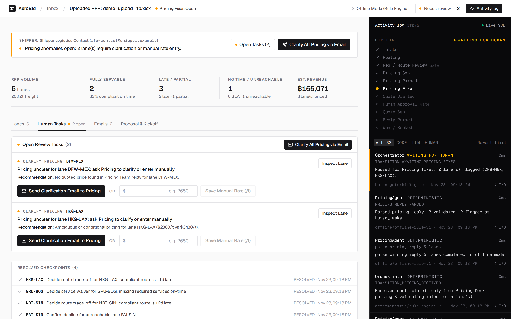
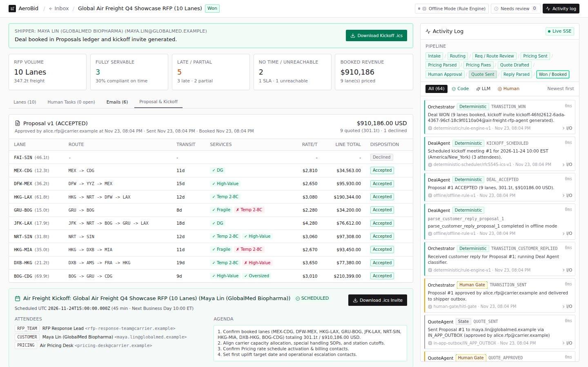
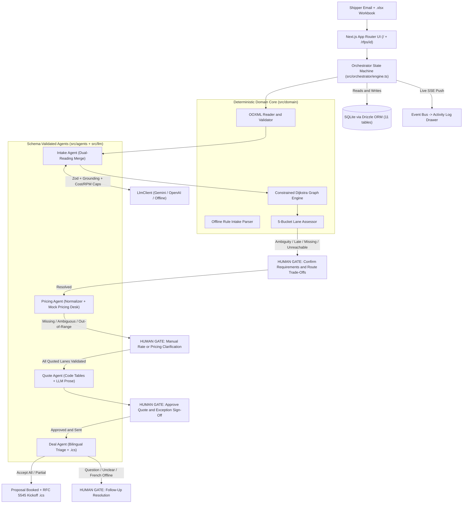

# AeroBid: Air Freight RFP Automation Workbench

AeroBid automates custom air-freight Request for Proposal (RFP) evaluation for a carrier RFP Response Team. The application splits work strictly between deterministic algorithms (constrained Dijkstra routing, unit normalization, pricing arithmetic, RFC 5545 `.ics` generation) and schema-validated LLM agents (shipper email extraction, unstructured pricing parsing, quote framing prose, bilingual customer reply triage), with blocking human checkpoints before any binding commercial commitment.

---

## Screenshots

### RFP Workspace and Route Trade-Off Table


### Human Review Queue (Route Decisions, Pricing Fixes, Quote Sign-Off)


### Won Proposal Summary and Kickoff `.ics` Invite


---

## Quick Start

### 1. Offline Mode (Zero API Key, 2 Commands)

All workflows run without external credentials using rule-based deterministic agents and a pre-seeded 10-lane showcase RFP covering all five feasibility buckets from `Air_Freight_RFP_Mock_Data.xlsx`:

```bash
npm install
npm run dev
```

Open [http://localhost:3000](http://localhost:3000) to inspect the pre-seeded showcase RFP, upload a `.xlsx` workbook, load all 100 lanes, or submit custom lane rows.

> **Using `pnpm` and WSL:** All `package.json` scripts (`test`, `e2e`, `eval`, `lint`, `typecheck`, `check:secrets`) run cleanly with `pnpm` (`pnpm install && pnpm dev`, `pnpm test`, `pnpm e2e`, `pnpm eval`) on Linux, macOS, and WSL. On Windows over a WSL UNC mount (`\\wsl.localhost\...`), run `npm` or `pnpm` inside your WSL Linux shell rather than Windows over Plan9 to avoid symlink errors during package install and Next builds.

### 2. Live LLM Mode and Optional SMTP

Copy the environment template and set `GEMINI_API_KEY` (default: `gemini-2.5-flash`) or `OPENAI_API_KEY` (`gpt-4o-mini` fallback):

```bash
cp .env.example .env.local
# Add GEMINI_API_KEY=... or OPENAI_API_KEY=...
npm run dev
```

Optional `.env.local` settings:
- `LLM_PROVIDER=auto | gemini | openai | offline` (or toggle per session from the header mode pill)
- `LLM_MAX_RPM=30` (sliding 60-second rate cap on live LLM calls)
- `LLM_MAX_COST_USD_PER_RUN=0.50` (cumulative USD spend guardrail per client instance)
- `SMTP_HOST`, `SMTP_PORT`, `SMTP_SECURE`, `SMTP_USER`, `SMTP_PASS`, `SMTP_FROM` (when unset, **Approve & Send** writes the email directly to the in-app outbox)

### 3. Docker and Deployment Status

Build and run with a persistent `/data` volume for SQLite:

```bash
docker build -t air-freight-rfp-agent .
docker run -p 3000:3000 -v rfp_data:/data -e LLM_PROVIDER=offline air-freight-rfp-agent
```

**Cloud Deployment Note:** A multi-stage `Dockerfile` and `.dockerignore` (`node:22-bookworm-slim`, `DATABASE_URL=file:/data/rfp.db`, `Air_Freight_RFP_Mock_Data.xlsx` bundled) are included. Cloud hosting (Render, Railway, or Vercel + Turso) was skipped per the brief's >1-hour rule because the Docker daemon is disabled in this environment and no cloud CLI or remote host is configured locally.

---

## Architecture Overview



### Responsibility Split

| Subsystem | Deterministic Code | AI / LLM Role | Fail-Closed Guardrail |
| :--- | :--- | :--- | :--- |
| **XLSX Loading** | Pure JS ZIP + SAX parser (`saxes`), airport and numeric validation | None | Malformed rows produce structured `DataIssue` records, never crashes |
| **Requirement Extraction** | Regex, negation, and O-D consistency check (`extractRequirementsOffline`) | Structured extraction (`IntakeLlmOutputSchema`) + dual-reading diff | LLM/rule disagreement, ungrounded quote, or confidence `< 0.85` creates `CONFIRM_REQUIREMENTS` task |
| **Flight Routing** | Multi-hop constrained Dijkstra minimizing transit days then legs (`findBestRoute`) | None (never delegated to an LLM) | Exact per-leg service gap attribution (`LegServiceGap[]`) |
| **Pricing Normalization** | `/kg` to `/ton` (`x1,000`), range bounds (`$500-$15,000/t`), duplicate checks | Unstructured reply extraction and mock Pricing reply prose | Missing, ambiguous, ungrounded, or out-of-range rates open `CLARIFY_PRICING` tasks; zero silent guesses |
| **Quote Assembly** | Lane tables, routes, SLAs, service flags, dollar totals, plain-text mirror | Greeting, summary paragraph, closing only | Hard backend gate blocks sending until `APPROVE_QUOTE` sign-off and zero open tasks |
| **Deal & Kickoff** | `proposal_lanes` persistence, `.ics` UTC conversion (`10:00 ET`), agenda | Reply intent classification (`DealAgent`) | Tentative, question, invalid JSON, or French offline reply opens `CUSTOMER_REPLY_REVIEW` task |

---

## Brief Requirements to Code Mapping

| Brief Requirement | Where It Lives in the UI | Implementation |
| :--- | :--- | :--- |
| **Ingest shipper RFP `.xlsx`, emails, and Transit Table** | Inbox **Email + Table**, **Upload .xlsx**, and **Presets** (`/`), `POST /api/rfps` | [`src/domain/xlsx-reader.ts`](src/domain/xlsx-reader.ts), [`src/domain/loader.ts`](src/domain/loader.ts), [`src/components/RfpInboxClient.tsx`](src/components/RfpInboxClient.tsx) |
| **Extract special requirements with evidence and confidence** | Lane drawer **Shipper Request & Evidence** (`evidenceJson`, confidence %) | [`src/domain/requirements.ts`](src/domain/requirements.ts), [`src/agents/intake.ts`](src/agents/intake.ts), [`data/gold_requirements.json`](data/gold_requirements.json) |
| **Route freight and surface trade-offs** | Workspace summary cards, filterable **Lanes** table, and drawer **Route Options** | [`src/domain/routing.ts`](src/domain/routing.ts), [`src/domain/assessment.ts`](src/domain/assessment.ts), [`src/components/LaneTable.tsx`](src/components/LaneTable.tsx), [`src/components/LaneDetailDrawer.tsx`](src/components/LaneDetailDrawer.tsx) |
| **Email Pricing team and parse unstructured replies** | **Request Pricing from Desk** action and **Pricing desk thread** under **Emails** | [`src/agents/pricing.ts`](src/agents/pricing.ts), [`src/pricing/mock-pricing-team.ts`](src/pricing/mock-pricing-team.ts), [`src/components/EmailsPanel.tsx`](src/components/EmailsPanel.tsx) |
| **Flag pricing gaps and clarify or override rates** | **Human Tasks** queue (`CLARIFY_PRICING`: **Send Clarification Email** or **Save Manual Rate**) | [`src/agents/pricing.ts`](src/agents/pricing.ts), [`src/components/HumanTasksPanel.tsx`](src/components/HumanTasksPanel.tsx) |
| **Draft, approve, and send customer quote** | **Proposal & Kickoff** table, **Markdown / Plain text** preview, and **Approve & Send** gate | [`src/agents/quote.ts`](src/agents/quote.ts), [`src/lib/email/smtp.ts`](src/lib/email/smtp.ts), [`src/app/api/rfps/[id]/quote/approve-send/route.ts`](src/app/api/rfps/%5Bid%5D/quote/approve-send/route.ts) |
| **Handle customer replies, book deal, and export `.ics`** | **Customer Reply Simulator** (`Accept All`, `Accept Selected Lanes`, `Question`, `Unclear`, `Reject`) and `.ics` download | [`src/agents/deal.ts`](src/agents/deal.ts), [`src/deal/mock-customer.ts`](src/deal/mock-customer.ts), [`src/deal/ics.ts`](src/deal/ics.ts), [`src/app/api/rfps/[id]/kickoff.ics/route.ts`](src/app/api/rfps/%5Bid%5D/kickoff.ics/route.ts) |
| **Pipeline state machine and live trace stream** | Header **Activity log** toggle, pipeline stage bar, and live SSE event inspector | [`src/orchestrator/states.ts`](src/orchestrator/states.ts), [`src/orchestrator/engine.ts`](src/orchestrator/engine.ts), [`src/orchestrator/event-bus.ts`](src/orchestrator/event-bus.ts), [`src/components/AgentOrchestrationPanel.tsx`](src/components/AgentOrchestrationPanel.tsx) |
| **Relational SQLite persistence (11 tables)** | Local SQLite DB (`file:./data/rfp.db` in Node/Linux; `:memory:` auto-fallback on UNC mounts) | [`src/db/schema.ts`](src/db/schema.ts), [`src/db/migrate.ts`](src/db/migrate.ts), [`src/db/index.ts`](src/db/index.ts) |

---

## Human-in-the-Loop Checkpoints

Every commercial commitment, SLA trade-off, or uncertain model output transitions the orchestrator into a `WAITING_FOR_HUMAN` state and writes a persistent `human_tasks` row:

1. **`CONFIRM_REQUIREMENTS` (`AWAITING_REQUIREMENT_CONFIRMATION`):** Fires when rules and LLM disagree, a quoted phrase is ungrounded, confidence falls below `0.85`, or the email names an out-of-catalog service (e.g., `-20 C` frozen or dry ice).
2. **`LANE_ROUTE_DECISION` (`AWAITING_REQUIREMENT_CONFIRMATION`):** Fires on `COMPLIANT_BUT_LATE`, `ON_TIME_BUT_MISSING_SERVICES`, `NO_ROUTE_IN_TIME`, and `UNREACHABLE` lanes. Commercial analysts choose whether to quote late, quote partial services with disclosure, or decline.
3. **`CLARIFY_PRICING` (`AWAITING_PRICING_FIXES`):** Fires on omitted lanes, conflicting numbers, ungrounded quotes, or out-of-range rates (`< $500/t` or `> $15,000/t`). Operators trigger an automated clarification email or record a manually confirmed spot rate.
4. **`APPROVE_QUOTE` (`AWAITING_APPROVAL`):** Backend gate (`ApprovalGateError`, HTTP `409`) blocking dispatch until an approver (`approved_by`, `approved_at`) signs off and zero unresolved tasks remain (unless explicitly accepted with an exception note).
5. **`CUSTOMER_QUESTION` and `CUSTOMER_REPLY_REVIEW` (`NEEDS_FOLLOW_UP`):** Fires on shipper questions, hedged replies, empty bodies, or French replies in Offline Mode so the deal ledger never auto-books `WON` or `LOST` by guessing.

---

## Reproducible Results on `Air_Freight_RFP_Mock_Data.xlsx`

### Dataset and Routing (`scripts/analyze-data.py` & `tests/domain/assessment.test.ts`)
- **Input Scope:** `100` unique shipper lanes (`4,008.4` metric tons) over `100` directed flights and `20` airports.
- **100/100 TypeScript-Python Parity:** Every classification, shortest transit time, hop count, and airport path matches the independent Python reference analyzer:
  - `FULLY_SERVABLE`: **45 lanes** (`15/15` "standard general cargo / no special services")
  - `COMPLIANT_BUT_LATE`: **44 lanes** (`35` have a faster non-compliant on-time route; `9` do not)
  - `ON_TIME_BUT_MISSING_SERVICES`: **5 lanes**
  - `NO_ROUTE_IN_TIME`: **1 lane**
  - `UNREACHABLE`: **5 lanes** (touching `ANC` or `FAI`, which lack flights in the Transit Table)

### Intake Evaluation (`npm run eval:intake -- --mode offline` -> `out/eval_intake.md`)
- **Exact-Match Rate vs `data/gold_requirements.json`:** **100 / 100 (100.00%)**
- **Micro Precision / Recall / F1:** **100.00% / 100.00% / 100.00%** across all 5 canonical services and `15/15` standard cargo controls
- **Cost and Runtime (Offline Mode):** **\$0.000000** token cost, **`0` human-task false alarms**, **50 ms** runtime *(Live Gemini/OpenAI eval runs with `--mode auto` when a funded key is set; live retry, schema validation, timeout, RPM cap, and cost cap logic is unit-tested against stubbed transports.)*

### Pricing Parser Evaluation (`npm run eval:pricing` -> `out/eval_pricing.md`)
Measured across **5 batches / 40 lane-quote instances** against hidden deterministic true prices:
- **Clean Priced Lanes Exact Match:** **29 / 29 (100.00%)** (`USD_PER_T`: 11/11, `DOLLAR_PER_TON`: 9/9, `PER_KG` x 1,000: 9/9)
- **Intentional Anomaly Detection:** **11 / 11 (100.00%)** (`MISSING_PRICE`: 5/5, `AMBIGUOUS_PRICE`: 5/5, `OUT_OF_RANGE_PRICE` at `$45,000/t`: 1/1) converted into `CLARIFY_PRICING` human tasks
- **Silent Guesses / False Positives:** **0** / **0**
- **Clarification Follow-Up (Batch 1):** **2 / 2** resolved to exact true prices

---

## Documentation and Verification

- Modeling decisions and edge-case rules: [`docs/ASSUMPTIONS.md`](docs/ASSUMPTIONS.md)
- Architecture, schema, and pricing formula: [`docs/DESIGN.md`](docs/DESIGN.md)
- CI checks (`.github/workflows/ci.yml`):
  - `npm run check:secrets`: scans tracked files and full git history for leaked `.env*` files, API keys, and PEM keys
  - `npm run lint`: ESLint (`eslint-config-next/core-web-vitals` + `typescript`)
  - `npm run typecheck`: `tsc --noEmit`
  - `npm test`: `tsx --test "tests/**/*.test.ts"` covering domain parity, all agents, rate/cost caps, orchestrator state machine, and all 8 required edge cases
  - `npm run eval`: offline intake + pricing evaluations
  - `npm run e2e`: Playwright Chromium test (`e2e/demo-rfp.spec.ts`) uploading `tests/fixtures/demo_upload_rfp.xlsx` and completing the full flow to `WON` and `.ics` download

---

## Trade-Offs and Next Steps

1. **Real Email Delivery and Webhooks:** Swap simulated reply triggers for an inbound webhook (Resend, Microsoft Graph, or IMAP) feeding the existing `emails` table and `parsePricingReply` / `handleCustomerReply` functions.
2. **Interline Partner Routing:** Query partner carrier schedules or road-feeder legs for the 5 `ANC`/`FAI` `UNREACHABLE` and `NO_ROUTE_IN_TIME` lanes instead of defaulting to `DECLINE`.
3. **Win/Loss Pricing Feedback:** Replace the static formulaic Mock Pricing Team with historical win/loss rate elasticity and current fuel-surcharge tables.
4. **Authentication and Role Separation:** Replace the free-text `approved_by` field with SSO roles separating RFP analysts from commercial approvers, backed by append-only audit logs.
5. **Durable Background Workers:** Move 100+ lane batch intake and pricing cycles from synchronous API handlers onto a queue worker with per-tenant rate budgets.

---

## How AI Tools Were Used

An AI coding assistant accelerated boilerplate work across Next.js UI components, Tailwind styling, pure-JS OOXML parsing, and Playwright selectors. I defined the architecture, separated deterministic graph/financial math from LLM prose, labeled all `100` gold requirements in `data/gold_requirements.json`, built the independent Python parity script, tuned fail-closed escalation thresholds, and audited every diff and test failure.
