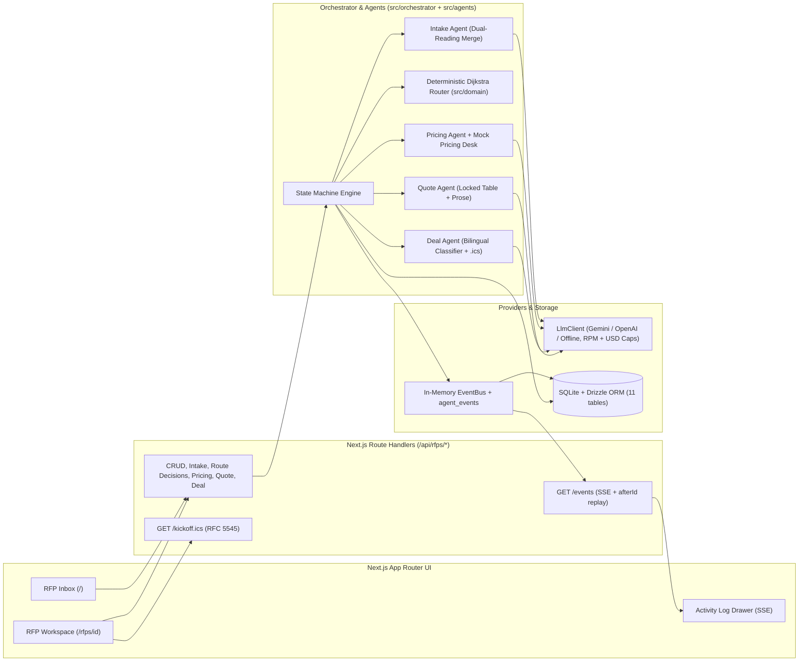
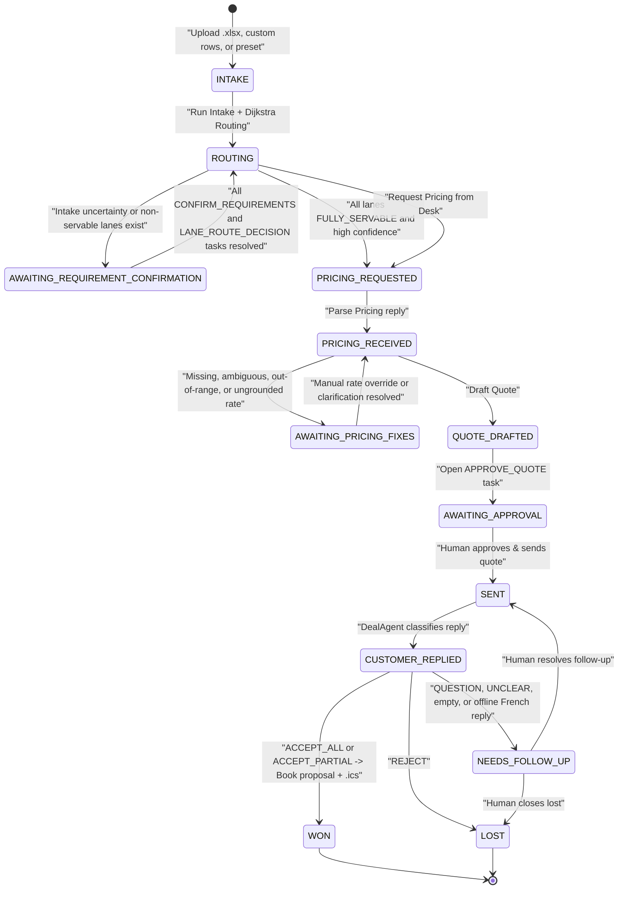
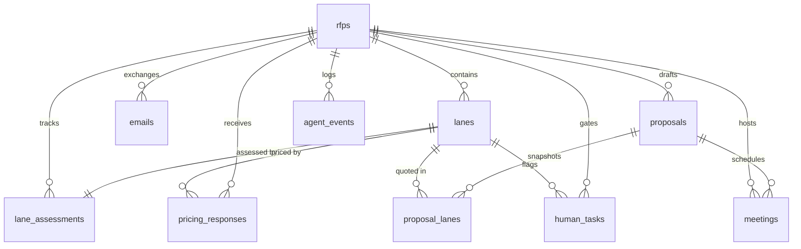

# System Architecture and Technical Design

**Project:** `air-freight-rfp-agent` (AeroBid Air Freight RFP Workbench)
**Audience:** Carrier RFP Response Team (e.g., DHL Global Forwarding)
**Goal:** Pair deterministic multi-leg network routing, compliance math, pricing bounds checking, and SQLite persistence with schema-validated LLM agents and mandatory human checkpoints.

---

## 1. Core Design Invariants

1. **Code Where There Is a Right Answer:** Constrained Dijkstra shortest-path routing, service intersection across flight legs, SLA classification, Pareto partial-service fallbacks, `/kg` to `/ton` conversions, proposal dollar math, RFC 5545 `.ics` generation, and SQL accounting execute in pure TypeScript functions covered by unit tests.
2. **Bounded LLM Scope:** LLMs only handle unstructured text: shipper email service extraction, messy Pricing Desk reply parsing (+ optional mock Pricing prose rewrite), quote greeting/closing prose, and bilingual shipper reply classification. Zero numbers in outgoing quotes come from LLM text.
3. **Fail-Closed Escalation:** Every LLM response passes a Zod schema and a substring quote-grounding check (`evidenceQuote`). Schema failures (after 1 retry), timeouts, rate/cost cap blocks, confidence `< 0.85`, rule-vs-LLM disagreements, missing/ambiguous/out-of-range prices, or offline French customer replies create blocking `human_tasks` records rather than silent guesses.
4. **Full Offline Mode:** When no API keys exist (`GEMINI_API_KEY` and `OPENAI_API_KEY` unset) or `LLM_PROVIDER=offline` is active, the same orchestrator, Zod contracts, HITL gates, SSE stream, and SQLite state machine run deterministically without network access.

---

## 2. Dataset Findings Driving the Design

Measured via [`scripts/analyze-data.py`](../scripts/analyze-data.py) on [`data/Air_Freight_RFP_Mock_Data.xlsx`](../data/Air_Freight_RFP_Mock_Data.xlsx):

| Metric | Observed Value | Design Consequence |
| :--- | :--- | :--- |
| Shipper lanes | `100` unique O-D pairs (`4,008.4` tons total, `2.1-79.9t`, max `3-25d`) | Support both a 10-lane Showcase preset and full 100-lane batch imports. |
| Flight network | `20` airports, `100` directed flights (`2-14d` per leg, `0` duplicates/self-loops) | Sparse graph (`5.44` avg out-degree in main component); multi-hop routing required. |
| Direct flight coverage | `34 / 100` lanes have direct flights (`16` compliant on time; `2` multi-hop `FULLY_SERVABLE`: `SIN-HKG`, `BOG-CDG`) | Direct routes can lack required services (`MEX-LHR-CDG` is `10d` vs direct `11d`, yet `MEX-LHR` lacks `Dangerous goods`). |
| Special services | `0` services: `15`, `1` service: `64`, `2` services: `21` across 5 types (`21-22` each) | Must support both "standard general cargo" negatives and varied natural-language synonyms. |
| Connectivity | 2 components: 18 connected airports (`98` flights) + isolated `ANC`/`FAI` (`2` flights) | `5` lanes touching `ANC`/`FAI` (`FAI-SIN`, `GRU-FAI`, `ANC-LHR`, `JFK-ANC`, `NRT-ANC`) are provably `UNREACHABLE`. |
| Lane feasibility split | `FULLY_SERVABLE: 45` (`16` 1-hop, `20` 2-hop, `6` 3-hop, `3` 4-hop), `COMPLIANT_BUT_LATE: 44` (`35` w/ faster non-compliant option, `9` without), `ON_TIME_BUT_MISSING_SERVICES: 5`, `NO_ROUTE_IN_TIME: 1`, `UNREACHABLE: 5` | **55 of 100 lanes fail strict fulfillment.** Exception triage (late compliant vs partial on-time vs decline) must sit at the center of the UI. |

---

## 3. System Architecture

---

## 4. State Machine and Module Contracts

### Orchestrator Lifecycle (`src/orchestrator/states.ts` & `src/orchestrator/engine.ts`)

### Core Modules

1. **Workbook and Data Loading (`src/domain/xlsx-reader.ts`, `src/domain/loader.ts`):**
   Pure-JS OOXML reader built on `jszip` + `saxes` (`xmlns: true`) handling both namespace-prefixed (`x:worksheet`) and unprefixed sheets, shared strings, formula strings, and UTF-8 BOMs. Validates IATA 3-letter codes and positive numbers, deduplicates duplicate lanes with warnings, and collects structured `DataIssue[]` errors instead of throwing on bad spreadsheets.
2. **Requirement Extraction (`src/domain/requirements.ts`, `src/agents/intake.ts`):**
   Dual-reading pipeline comparing deterministic regex/negation output (`extractRequirementsOffline`) against Zod-validated LLM extraction (`IntakeLlmOutputSchema`). Standard general cargo returns `requestedServices: []` with high confidence. Any rule/LLM mismatch, ungrounded quote, out-of-catalog term (such as `-20 C` or dry ice), or confidence `< 0.85` generates a `CONFIRM_REQUIREMENTS` human task showing both readings.
3. **Constrained Routing (`src/domain/routing.ts`, `src/domain/assessment.ts`):**
   Filters edges by `requestedServices ⊆ edge.availableServices` and runs Dijkstra minimizing `(totalTransitDays, legCount, airportTuple)` to find `bestCompliantRoute` alongside unconstrained `fastestUnconstrainedRoute`. For non-servable reachable lanes, enumerates non-empty subsets of requested services to retain Pareto-maximal on-time partial alternatives with explicit per-leg missing-service gaps (`LegServiceGap[]`). Verified `100/100` against `scripts/analyze-data.py`.
4. **Pricing Agent and Mock Pricing Team (`src/agents/pricing.ts`, `src/pricing/mock-pricing-team.ts`):**
   - Computes hidden ground-truth rates per ton from legs $L = \max(1, |\text{airports}| - 1)$, transit days $D$, fulfillable services $S_{\text{fulfilled}}$, and tonnage $T$:
     $$\text{BaseRate}(L, D) = 1200 + 350 \cdot L + 60 \cdot D$$
     - Service surcharges per ton: `TEMP_CONTROLLED` `+$450`, `DANGEROUS_GOODS` `+$600`, `HIGH_VALUE_SECURITY` `+$500`, `FRAGILE` `+$250`, `OVERSIZED` `+$400`.
     - Volume discount: `< 20t` -> `0%`, `20-49.9t` -> `5%`, `>= 50t` -> `10%`.
     - Nearest `$10/t` rounding so `/kg` equivalents stay exact to 2 decimal places:
     $$\text{TruePricePerTonUSD} = 10 \cdot \text{round}\!\left(\frac{\left(\text{BaseRate}(L, D) + \sum_{s \in S_{\text{fulfilled}}} \text{Surcharge}(s)\right) \cdot (1 - \text{Discount}(T))}{10}\right)$$
   - Generates mixed prose/table replies across `USD 2,450/t`, `$2,450 per ton`, and `$2.45 per kg`, injecting intentional missing and ambiguous lanes cleanly separated via `_evalOnlyGroundTruth`.
   - `parsePricingReply` normalizes units (`x1,000` for `/kg`), enforces `[$500, $15,000]/t` sanity bounds and verbatim evidence grounding, and opens `CLARIFY_PRICING` human tasks on any gap or anomaly.
5. **Quote Agent and Approval Gate (`src/agents/quote.ts`, `src/lib/email/smtp.ts`):**
   Assembles Markdown and plain-text customer quotes directly from SQL records (`route`, transit SLA delta, service status with failing leg names, `rate/t`, line totals, and exception disclosures). The LLM only writes bounded greeting, summary, and closing slots. `approveCustomerQuote` enforces `ApprovalGateError` (HTTP `409`) until all pre-quote human tasks are resolved or explicitly overridden and records `approvedBy` + `approvedAt`. Sending stores to the `emails` outbox and optionally relays via `SMTP_*` variables.
6. **Deal Agent and Kickoff `.ics` (`src/agents/deal.ts`, `src/deal/ics.ts`, `src/deal/mock-customer.ts`):**
   Classifies customer replies into `ACCEPT_ALL`, `ACCEPT_PARTIAL`, `REJECT`, `QUESTION`, or `UNCLEAR`. Offline mode detects empty bodies and French-language cues (`isLikelyFrenchText`) and fails closed into `UNCLEAR` (`CUSTOMER_REPLY_REVIEW`) instead of risking a false booking; Live LLM mode carries bilingual instructions. Acceptance books `proposals` (`ACCEPTED`) + `proposal_lanes` + `meetings` scheduled at next business day `10:00 America/New_York` exported via `GET /api/rfps/[id]/kickoff.ics`.
7. **LLM Gateway and Guardrails (`src/llm/provider.ts`, `src/llm/types.ts`, `src/llm/pricing.ts`):**
   Supports Gemini (`gemini-2.5-flash`), OpenAI (`gpt-4o-mini`), and Offline rule execution with a 30s timeout, 1 automatic retry on `INVALID_JSON` or `SCHEMA_VALIDATION`, sliding `LLM_MAX_RPM` (default `30`), cumulative `LLM_MAX_COST_USD_PER_RUN` (default `$0.50`), and full `agent_events` telemetry.

---

## 5. SQLite Data Model (11 Tables in `src/db/schema.ts`)

Tables: `rfps`, `flights` (unique index on `origin, destination`), `lanes` (unique index on `rfp_id, lane_code`), `lane_assessments` (unique index on `lane_id`), `emails`, `pricing_responses`, `proposals`, `proposal_lanes`, `meetings`, `agent_events` (indexed on `rfp_id, id`), and `human_tasks` (indexed on `rfp_id, status`).

---

## 6. Tech Stack

| Layer | Selection | Rationale |
| :--- | :--- | :--- |
| **App & API** | Next.js 15 App Router + TypeScript (`strict: true`) | Single deployment unit serving React Server Components, REST handlers, and SSE endpoints. |
| **Styling** | Tailwind CSS v4 + custom neutral token set (`src/app/globals.css`) + Lucide icons | High-density workbench layout with tight spacing, zinc surfaces, and restrained state color coding. |
| **Database** | SQLite via Drizzle ORM + `@libsql/client` | Pure JS SQLite access with zero `node-gyp` native build issues across Windows and Linux (`:memory:` fallback on UNC shares). |
| **Live Events** | Server-Sent Events (`GET /api/rfps/[id]/events`) + in-memory `EventBus` | DB-backed replay via `afterId` plus push updates without separate broker infrastructure. |
| **LLM SDK** | Vercel AI SDK (`ai`, `@ai-sdk/google`, `@ai-sdk/openai`) + `zod` | Unified structured output (`generateObject`) across Gemini, OpenAI, and Offline providers. |
| **XLSX Parsing** | `jszip` + `saxes` | Namespace-aware streaming XML reader without `exceljs` bugs or transitive CVEs. |
| **Testing** | Node `node:test` via `tsx --test`, Python `openpyxl` parity test, Playwright Chromium | Sub-minute deterministic unit/edge suite plus full browser upload-to-WON E2E verification. |
