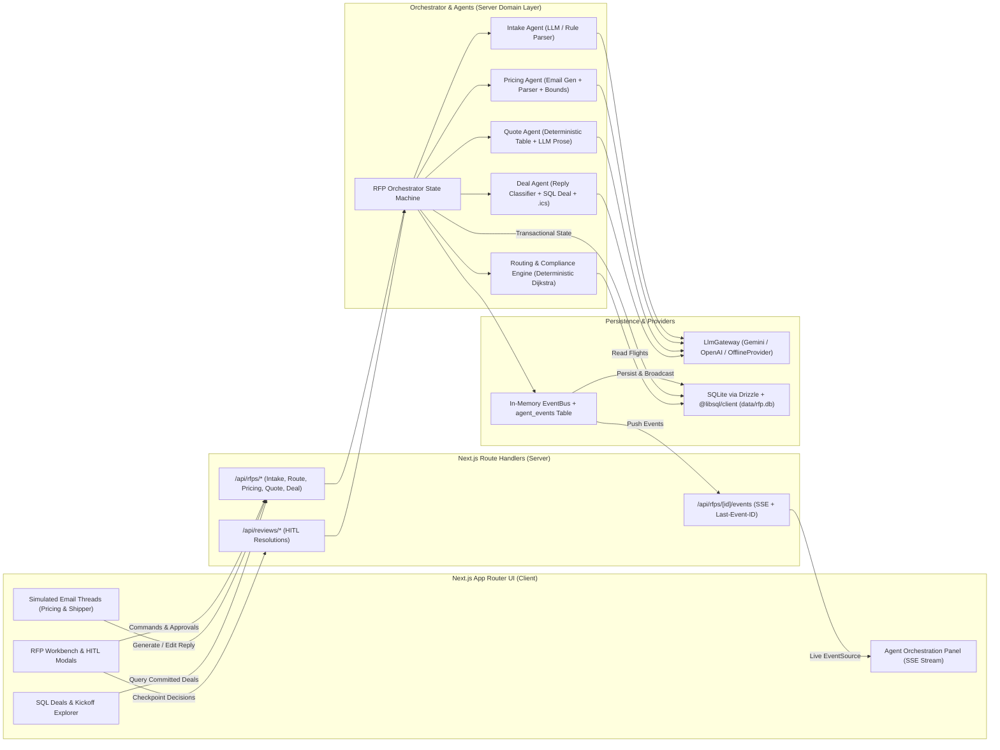
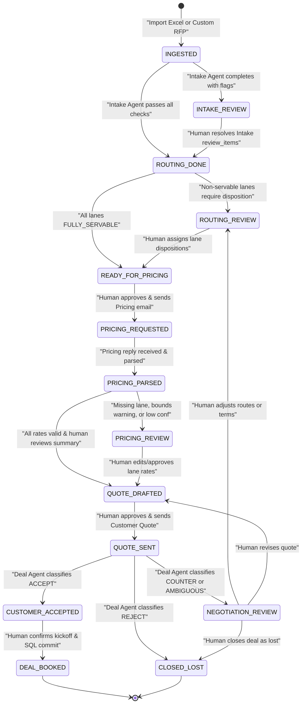
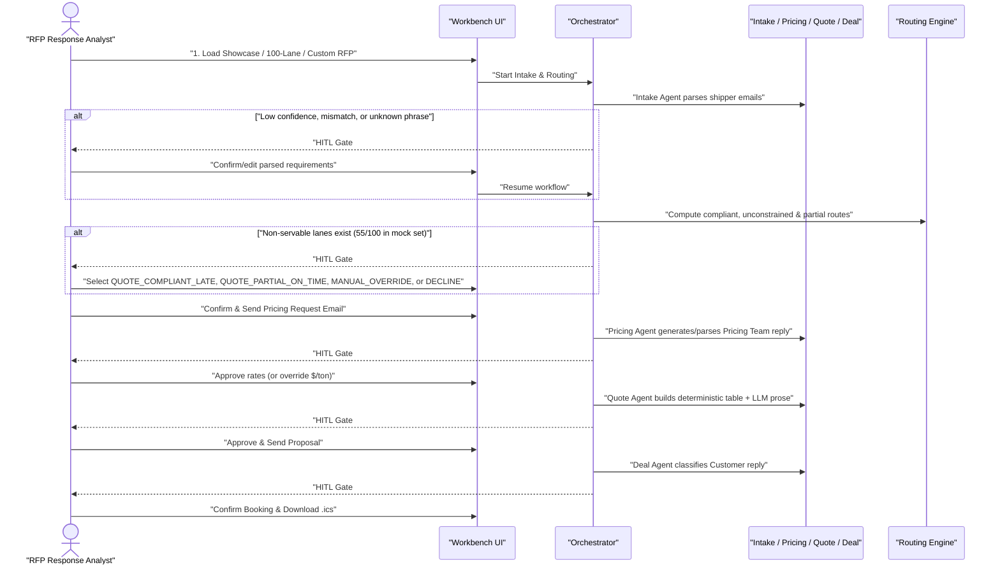
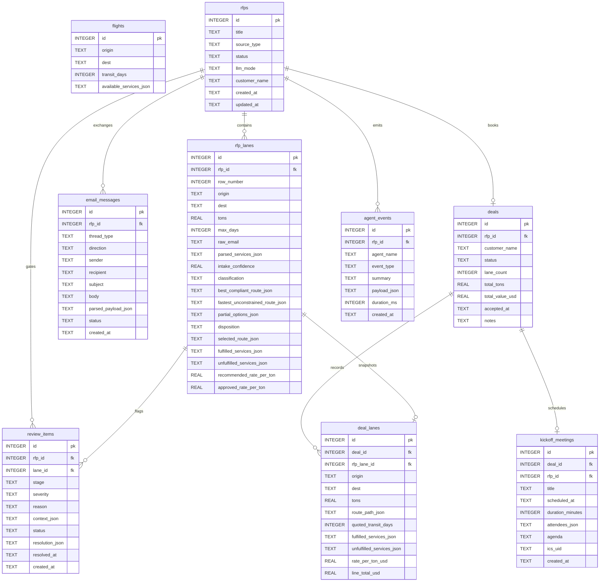

# System Architecture & Technical Design

**Project:** `air-freight-rfp-agent` — AI-Powered Air Freight RFP Automation Workbench
**Target Audience:** Client RFP Response Team (Air Cargo Carrier, e.g., DHL Global Forwarding)
**Design Goal:** Combine **100% deterministic network optimization, compliance math, and SQL accounting** with **schema-validated LLM unstructured-text agents**, transparent **Human-in-the-Loop (HITL) checkpoints**, and a live **Agent Orchestration panel**.

---

## 1. Architectural Principles (Non-Negotiable Invariants)

1. **Deterministic Core vs. LLM Boundary (Standing Rule #1):**
   All computations that have an exact right answer—graph shortest simple paths, end-to-end special-service intersection, SLA classification, Pareto partial-service fallbacks, per-lane/total dollar calculations, outgoing quote tables, and SQL persistence—execute in pure, unit-tested TypeScript functions. The LLM is strictly confined to four unstructured text tasks:
   - Reading unstructured shipper RFP emails,
   - Generating and parsing unstructured Pricing Team recommendation emails,
   - Drafting conversational cover prose around deterministically rendered quote tables,
   - Classifying unstructured shipper replies (Accept / Counter / Reject / Ambiguous).
   **Zero numeric values in outgoing emails are ever generated by the LLM:** the system renders the verified lane table from SQLite directly and injects only bounded narrative prose slots.
2. **Strict Schema Validation & Fail-Closed Escalation (Standing Rule #2):**
   Every LLM call validates against a strict Zod schema (`generateObject` in Live mode, structured output in Offline mode). Any schema failure, low confidence (`< 0.85`), O-D discrepancy, unrecognized requirement token, or out-of-band quote creates an explicit blocking `review_items` record for human resolution—never a silent fallback guess.
3. **Full Offline Mode Parity (Standing Rule #3):**
   With zero API keys configured (`GEMINI_API_KEY` and `OPENAI_API_KEY` unset) or when Offline Mode is toggled in the UI, the app executes the exact same orchestrator, Zod contracts, deterministic tools, HITL checkpoints, SSE events, and SQLite state machine via deterministic `OfflineProvider` implementations.
4. **Human Authority at Commercial Gates:**
   No customer quote email is sent, no pricing rate is committed to a customer proposal, and no deal/kickoff is written to the SQL Deals Ledger without an explicit human approval action.

---

## 2. Verified Dataset Insights Driving the Architecture

All numbers below come directly from running [`scripts/analyze-data.py`](../scripts/analyze-data.py) on [`data/Air_Freight_RFP_Mock_Data.xlsx`](../data/Air_Freight_RFP_Mock_Data.xlsx):

| Metric | Observed Value | Architectural Implication |
| :--- | :--- | :--- |
| Shipper RFP lanes | `100` unique O-D pairs (`4,008.4` tons total, `2.1–79.9t`, max transit `3–25d`) | Must support both a quick Showcase subset (`10` lanes) and full `100`-lane batch execution without UI lag or prompt-length failures. |
| Flight network | `20` airports, `100` directed flights (`2–14d` per leg, `0` duplicates, `0` self-loops) | Graph is sparse (`avg out-degree = 5.44` in main component); multi-hop routing is essential. |
| Direct flight coverage | `34 / 100` RFP lanes have a direct flight (`16` direct are compliant & on-time; `2` more are `FULLY_SERVABLE` via multi-hop: `SIN-HKG`, `BOG-CDG`) | Direct flights cannot be assumed optimal or compliant (e.g., `MEX-LHR-CDG` is `10d` vs `MEX-CDG` `11d`, yet `MEX-LHR` lacks `Dangerous goods`). |
| Special services requested | `0` services: `15`, `1` service: `64`, `2` services: `21` across `5` canonical types (`21–22` lanes each) | Rule-based + LLM intake must recognize varied natural-language phrasing (`"2-8 C"`, `"cold chain"`, `"refrigerated"`, `"high-value"`, `"secure handling"`) and detect end-to-end constraints. |
| Graph connectivity | `2` identical SCC/WCC components: `18` global airports (`98` flights) + isolated `ANC`/`FAI` (`2` flights) | `5` lanes touching `ANC`/`FAI` (`FAI-SIN`, `GRU-FAI`, `ANC-LHR`, `JFK-ANC`, `NRT-ANC`) are provably `UNREACHABLE` and must fail fast at routing. |
| Compliance-first classification | `FULLY_SERVABLE: 45` (`16` 1-hop, `20` 2-hop, `6` 3-hop, `3` 4-hop), `COMPLIANT_BUT_LATE: 44` (`35` also have an on-time non-compliant alternative; `9` do not), `ON_TIME_BUT_MISSING_SERVICES: 5`, `NO_ROUTE_IN_TIME: 1`, `UNREACHABLE: 5` | **Over half (`55 / 100`) of RFP lanes cannot be fulfilled as requested.** The UI cannot be a blind auto-quoter—it must center on exception triage (late compliant route vs. partial-service on-time route vs. decline). |

---

## 3. System Architecture & Data Flow



### Deterministic vs. LLM Responsibility Matrix

| Pipeline Stage | Deterministic Code (100% Exact) | LLM / Offline Template (Unstructured Text) | Validation / Guardrail |
| :--- | :--- | :--- | :--- |
| **1. Workbook / Lane Load** | Parse `.xlsx` columns (`exceljs`), validate airport codes, `tons > 0`, `max_days > 0`, insert `rfps` + `rfp_lanes`. | None | Reject malformed spreadsheets before agent start. |
| **2. Intake Extraction** | Regex pre-check, airport O-D consistency check, canonical service enum normalization, confidence gate. | Extract `{origin, dest, requestedServices[], unmappedPhrases[], notes, confidence}` from raw shipper email. | Zod schema + `confidence >= 0.85` + `unmappedPhrases.length == 0` + exact O-D match. Else **HITL Gate #1**. |
| **3. Network Routing & Compliance** | Kosaraju SCC reachability, Dijkstra shortest simple path on `(days, hops, path)` for compliant & unconstrained routes, Pareto-maximal partial-service subsets, 5-bucket classification. | None | Pure mathematical graph computation; verified 100/100 parity with [`scripts/analyze-data.py`](../scripts/analyze-data.py). |
| **4. Exception Triage** | Compute SLA delta (`best_compliant_days - max_days`) and missing services per option; enforce required dispositions. | Optional concise summary rationale for reviewer card (non-authoritative). | Non-`FULLY_SERVABLE` lanes block progression until human sets disposition (**HITL Gate #2**). |
| **5. Pricing Outreach & Reply Parsing** | Select approved quotable lanes, compute base cost heuristics for mock pricing bounds, compute `total_quote = rate_per_ton * tons`, check completeness and `[150, 25000]` $/ton bounds. | Draft Pricing Team request email; generate realistic unstructured Pricing Team reply (mock); parse unstructured Pricing reply into `{laneCode, ratePerTonUsd, includedServices[], conditions, confidence}`. | Missing lane, unrecognized lane, unapproved surcharge, `confidence < 0.85`, or out-of-band rate triggers **HITL Gate #3**. |
| **6. Proposal Quote Drafting** | Render exact route string (`HKG -> NRT -> DFW -> LAX`), transit days, fulfilled vs. unfulfilled service badges, approved `$/ton`, and total freight `$` from SQL. | Draft polite executive intro & closing prose matching the RFP tone (with strict prohibition on altering numbers). | **Deterministic Table Lock:** prose cannot contain substituted numbers; human previews and clicks **"Approve & Send Quote"** (**HITL Gate #4**). |
| **7. Customer Reply & Deal Closure** | Transactional SQLite write to `deals`, `deal_lanes`, `kickoff_meetings`; generate RFC 5545 `.ics` invite. | Generate simulated customer reply (Accept / Counter / Reject) or parse user-pasted reply into `{intent, acceptedLanes[], requestedChanges[], kickoffPreference, confidence}`. | Counter-offer / Ambiguous / low confidence escalates to HITL; even clean `ACCEPT` requires human click on **"Confirm Kickoff & Commit Deal to SQL"**. |

---

## 4. Multi-Agent Orchestration & RFP State Machine

### RFP Lifecycle State Machine



### Orchestrator & Specialist Agent Contracts

All agents implement a unified `AgentStep` contract returning `{ status, output, events[], reviewItems[] }` and emit structured `agent_events` before and after every tool/LLM boundary:

1. **Orchestrator (`src/lib/agents/orchestrator.ts`)**
   - Owns the persisted RFP state transitions, enforces gate invariants (refusing to advance while `status = 'OPEN'` `review_items` exist for the current stage), coordinates step sequencing, and publishes real-time `agent_events` to SQLite + SSE subscribers.
2. **Intake Agent (`src/lib/agents/intake-agent.ts`)**
   - **Input:** Raw lane rows (`origin`, `dest`, `tons`, `maxDays`, `rawEmail`).
   - **LLM / Offline Output Schema (`IntakeExtractionSchema`):**
     ```ts
     z.object({
       originMentioned: z.string().length(3),
       destMentioned: z.string().length(3),
       requestedServices: z.array(CanonicalServiceEnum),
       continuousConstraintDetected: z.boolean(),
       unmappedPhrases: z.array(z.string()),
       confidence: z.number().min(0).max(1),
       rationale: z.string(),
     })
     ```
   - **Offline Implementation:** Deterministic regex matcher over the 5 canonical services + negation detector + leftover requirement clause detector.
   - **Escalation Triggers:** Schema failure, `confidence < 0.85`, airport mismatch with spreadsheet row, or non-empty `unmappedPhrases`.
3. **Routing & Compliance Tool (`src/lib/routing/engine.ts`) — Pure Deterministic**
   - **Input:** `flights` adjacency list from SQLite + normalized lane requirements.
   - **Algorithm:**
     1. Run Kosaraju SCC to detect connectivity immediately (`UNREACHABLE` if no path).
     2. Run Dijkstra with key `(totalDays, hopCount, pathTuple)` filtering edges by `requestedServices ⊆ edge.services` -> `bestCompliantRoute`.
     3. Run unconstrained Dijkstra -> `fastestUnconstrainedRoute`.
     4. If lane is not `FULLY_SERVABLE`, evaluate proper subsets of `requestedServices` down from size $k-1$ to $1$ to collect all Pareto-maximal `partialOnTimeOptions`.
     5. Assign `categoryComplianceFirst`, `categoryTimeFirst`, and default `disposition` (`QUOTE_COMPLIANT` for `FULLY_SERVABLE`, `PENDING_REVIEW` for non-servable except `UNREACHABLE` defaulting to `DECLINE` [overridable if reviewer adds a manual flight]).
4. **Pricing Agent (`src/agents/pricing.ts`) & Isolated Mock Pricing Team (`src/pricing/mock-pricing-team.ts`)**
   - **Sub-step A (Outbound Request Draft):** Deterministically formats each lane's `laneId`, `origin`, `destination`, `tons`, `route` (airport sequence), `transitDays`, and `requested` vs `fulfillable` services, persisting an outbound email (`threadType: "PRICING"`, `direction: "outbound"`, `counterparty: "pricing"`) into `emails`.
   - **Sub-step B (Isolated Mock Pricing Team & True Price Model):** Operates as a separate module simulating the carrier's Pricing Desk. It first computes a deterministic **true price per ton (USD)** using an explicit, transparent cost formula:
     - **Base rate per ton (USD)** from number of flight legs $L = \max(1, \text{routeAirports.length} - 1)$ and total transit days $D$:
       $$\text{BaseRate}(L, D) = 1200 + 350 \cdot L + 60 \cdot D$$
     - **Per-service surcharge per ton (USD)** summed across each fulfillable service $s \in S_{\text{fulfilled}}$:
       - `TEMP_CONTROLLED`: `+$450/ton`
       - `DANGEROUS_GOODS`: `+$600/ton`
       - `HIGH_VALUE_SECURITY`: `+$500/ton`
       - `FRAGILE`: `+$250/ton`
       - `OVERSIZED`: `+$400/ton`
     - **Volume discount** based on lane freight tonnage $T$:
       - $T < 20\text{t}$: $0\%$ ($\times 1.00$)
       - $20 \le T < 50\text{t}$: $5\%$ ($\times 0.95$)
       - $T \ge 50\text{t}$: $10\%$ ($\times 0.90$)
     - **True Price per Ton (USD)** rounded to the nearest `$10/ton` (so `$X.XX/kg` equivalents at $1\text{ ton} = 1,000\text{ kg}$ remain exact to two decimal places):
       $$\text{TruePricePerTonUSD} = 10 \cdot \text{round}\!\left(\frac{\left(\text{BaseRate}(L, D) + \sum_{s \in S_{\text{fulfilled}}} \text{Surcharge}(s)\right) \cdot (1 - \text{Discount}(T))}{10}\right)$$
     - The mock Pricing Team then renders an **unstructured email reply** mixing conversational prose and small tables, varied currency/unit formats (`"USD 2,450/t"`, `"$2,450 per ton"`, `"2.45 per kg"`), commercial notes (e.g., `"subject to capacity"`), plus intentional anomalies (e.g., 1 missing lane and 1 ambiguous figure). In Live LLM mode, the LLM rewrites prose for realism while preserving fixed numeric values; `_evalOnlyGroundTruth` is stored separately for evaluation and is never exposed to the parser.
   - **Sub-step C (Unstructured Reply Parser, Validator & Clarification Loop):** Parses the unstructured email into normalized USD/ton rates with verbatim evidence quotes, unit normalization (`per kg` $\times 1,000 \rightarrow$ `per ton`), and extracted conditions (`PricingParseSchema`). Deterministic validation checks that every requested lane has **exactly one** positive rate within sane bounds (`[$500, $15,000]/ton`) with grounded evidence. Any missing, ambiguous, out-of-range, or ungrounded lane is never guessed and instead creates a `human_tasks` item (`"Pricing unclear for lane X: ask Pricing to clarify or enter manually"`) supporting a one-click **"Send Clarification Email to Pricing"** round trip that resolves the task with Pricing's follow-up reply.
5. **Quote Agent (`src/lib/agents/quote-agent.ts`)**
   - **Deterministic Assembly:** Computes exact `totalLinePriceUsd = round(approvedRatePerTonUsd * tons, 2)` and grand proposal total, builds the structured per-lane comparison matrix:
     - Route (`A -> B -> C`) & total transit days vs requested max days,
     - Fulfilled special services vs explicitly flagged unfulfilled special services (for approved exception lanes),
     - Declined/Unserviceable lanes section (if any),
     - Approved `$ price / ton` and total `$` per lane.
   - **LLM / Offline Prose:** Generates executive greeting, commercial terms summary, and closing call-to-action. The deterministic Markdown/HTML table is injected directly into a template slot—never passed through an LLM rewrite.
6. **Deal Agent (`src/lib/agents/deal-agent.ts`)**
   - **Customer Reply Simulation / Input:** Supports preset simulated outcomes (`Accept Full Proposal`, `Counter-Offer on Late/Partial Lanes`, `Reject / Lost`, `Ambiguous Reply`) or arbitrary pasted email text.
   - **Classifier (`CustomerReplySchema`):**
     ```ts
     z.object({
       intent: z.enum(["ACCEPT", "COUNTER_OFFER", "REJECT", "AMBIGUOUS"]),
       acceptedLaneCodes: z.array(z.string()),
       requestedChanges: z.array(z.string()),
       proposedKickoffWindow: z.string().nullable(),
       confidence: z.number().min(0).max(1),
       summary: z.string(),
     })
     ```
   - **Deal Booking & Kickoff Generation:** Upon `ACCEPT` + human confirmation, executes a single Drizzle database transaction creating `deals`, `deal_lanes`, and `kickoff_meetings` (plus an `.ics` file endpoint) and emits `DEAL_BOOKED`.

---

## 5. Live "Agent Orchestration" Panel Architecture (SSE)

To satisfy the requirement to *"display what the AI agent is doing behind the scenes"* with zero polling overhead:

1. **Event Persistence + Pub/Sub (`src/lib/events/bus.ts`):**
   - Every orchestrator step, deterministic tool run, LLM call (including latency, provider/model, token usage or `"offline-deterministic"`, Zod validation status), and HITL pause writes an append-only row to `agent_events` (with monotonic `id`, `rfp_id`, `agent_name`, `event_type`, `summary`, `payload_json`, `duration_ms`, `created_at`).
   - Simultaneously emits on an in-memory per-`rfpId` `EventEmitter` (kept across Next.js hot reloads via `globalThis`).
2. **SSE Endpoint (`GET /api/rfps/[id]/events`):**
   - Reads the `Last-Event-ID` HTTP header (or `?afterId=` query param), replays any missed rows from SQLite `agent_events` in ascending `id` order, and then streams live events over `text/event-stream` with `20s` heartbeat comments.
3. **Orchestration Drawer UI:**
   - Docked collapsible right-hand panel showing live step timeline grouped by run/stage, color-coded badges (`ORCHESTRATOR`, `INTAKE`, `ROUTING_TOOL`, `PRICING`, `QUOTE`, `DEAL`, `HITL_GATE`), expandable JSON I/O payload inspector, provider badge (`Gemini 2.5 Flash` vs `Offline Rule Engine`), and latency metrics.

---

## 6. Human-in-the-Loop (HITL) Checkpoints



| Checkpoint | Blocking Trigger | What the Human Sees | Available Human Actions |
| :--- | :--- | :--- | :--- |
| **Gate #1: Intake Validation** | Schema error, `confidence < 0.85`, O-D mismatch, or `unmappedPhrases` present | Side-by-side raw shipper email, highlighted matched phrases, unmapped phrase alert, editable service checkboxes | Approve extracted services, edit services manually, re-run Intake |
| **Gate #2: Routing & Exception Triage** | Any lane classified `COMPLIANT_BUT_LATE`, `ON_TIME_BUT_MISSING_SERVICES`, `NO_ROUTE_IN_TIME`, or `UNREACHABLE` | Side-by-side cards comparing `Best Compliant Route` (with SLA overrun days) vs `Fastest On-Time Route` vs `Partial-Service Options` (e.g., `HKG-MIA`'s two options) | Choose `Quote Compliant (Late)`, `Quote Partial (On-Time)`, `Manual Route Override`, or `Decline Lane` (bulk actions supported for 100-lane RFPs) |
| **Gate #3: Pricing Outreach & Rate Approval** | Before sending Pricing email; after parsing Pricing reply (mandatory review of extracted rates + escalation on missing/out-of-band/low-confidence rates) | Outgoing Pricing email preview; raw Pricing reply (editable); parsed rate table (`$/ton`, total `$`, confidence, bounds flag) | Edit/send Pricing email; approve parsed rates, edit `$/ton` inline, or re-request Pricing |
| **Gate #4: Quote Sign-Off & Deal Closure** | Before sending Customer Proposal; after Customer reply before SQL Deal write | Full rendered Customer Quote email (locked numeric route/service/price table + editable prose); parsed customer intent + kickoff scheduler form | Edit cover prose, approve & send Quote; resolve counter-offer or confirm kickoff attendees/time and commit Deal to SQL |

---

## 7. SQL Data Model (SQLite via Drizzle ORM + `@libsql/client`)



### Key Indexing & Integrity Constraints
- `flights`: `UNIQUE INDEX flights_origin_dest_idx ON flights(origin, dest)`
- `rfp_lanes`: `UNIQUE INDEX rfp_lanes_rfp_od_idx ON rfp_lanes(rfp_id, origin, dest)`
- `review_items`: `INDEX review_items_rfp_status_idx ON review_items(rfp_id, status)`
- `agent_events`: `INDEX agent_events_rfp_id_idx ON agent_events(rfp_id, id)`
- `deals`: `UNIQUE INDEX deals_rfp_id_idx ON deals(rfp_id)` (prevents duplicate booking of the same RFP)

---

## 8. Tech Stack & Rationale

| Layer | Selection | Why This Choice Fits Best |
| :--- | :--- | :--- |
| **Framework & Language** | Next.js 15+ (App Router) + TypeScript (`strict: true`) | Unified full-stack server routes, streaming SSE endpoints, React Server Components, and zero separate backend deploy friction. |
| **UI & Styling** | Tailwind CSS + shadcn/ui + Lucide icons | Crisp enterprise workbench density (sticky headers, dense data tables with filters, badge taxonomy, slide-over Agent drawer). |
| **Database & ORM** | SQLite (`data/rfp.db`) via Drizzle ORM + `@libsql/client` | Pure JS/HTTP-compatible client with **zero native C++/node-gyp compilation** on Windows/WSL; seamless swap to Turso (`libsql://`) if deployed. |
| **Live Orchestration Stream** | Native Server-Sent Events (`ReadableStream` + `EventSource` with `Last-Event-ID`) | Standard HTTP streaming with DB-backed replay, no WebSocket daemon complexity, works cleanly in Next.js Route Handlers. |
| **AI SDK & Providers** | Vercel AI SDK (`ai`, `@ai-sdk/google`, `@ai-sdk/openai`) + `zod` | Unified `generateObject` / `generateText` abstraction across Gemini (`gemini-2.5-flash` default) and OpenAI (`gpt-4o-mini` fallback), cleanly swappable with `OfflineProvider`. |
| **Excel Ingestion** | `exceljs` | Pure JS `.xlsx` reader/writer supporting both seeding `Air_Freight_RFP_Mock_Data.xlsx` and live browser upload parsing. |
| **Testing** | Vitest (unit + parity + API integration) & Playwright (end-to-end UI + SSE + SQL verification) | Fast sub-second deterministic test feedback + real browser verification of multi-step HITL workflows and `.ics` downloads. |

---

## 9. UI Ergonomics & Demo Flows

- **Single-Workspace 5-Step Stepper:** `1. Intake -> 2. Routing & Triage -> 3. Pricing Team -> 4. Customer Quote -> 5. Deal & Kickoff`, with clear status badges (`PASS`, `NEEDS REVIEW`, `LOCKED`) on each step.
- **Always-Available Agent Orchestration Panel:** Persistent collapsible right-hand drawer showing live SSE events, latency, provider badge (`Offline Deterministic` vs `Gemini`), and raw JSON inspection for technical interviewers.
- **Filterable Network & Lane Explorer:** Filter lanes by any of the 5 classifications (`FULLY_SERVABLE`, `COMPLIANT_BUT_LATE`, `ON_TIME_BUT_MISSING_SERVICES`, `NO_ROUTE_IN_TIME`, `UNREACHABLE`), inspect leg-by-leg service availability pills, and inspect the 20-airport flight network directly.
- **Top-Bar Mode & Demo Controls:**
  - Quick-launch presets: **10-Lane Showcase RFP** (all 5 buckets + all 4 spot checks in seconds), **Full 100-Lane Workbook**, or **Upload Custom `.xlsx` / Raw Lane**.
  - **Offline / Live LLM Toggle** + **Deals Ledger (`/deals`)** page showing persisted SQL `deals`, `deal_lanes`, and `kickoff_meetings` with one-click `.ics` download.
